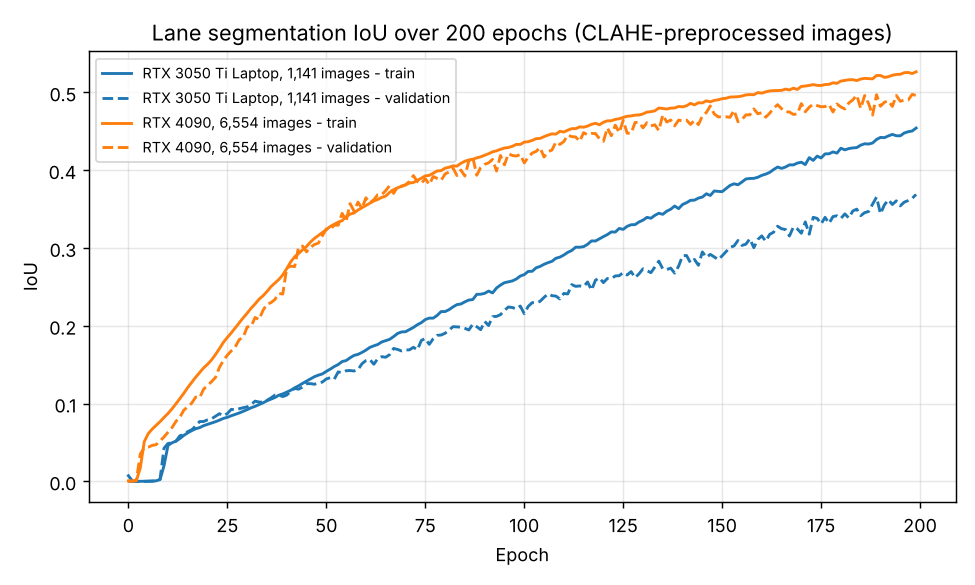
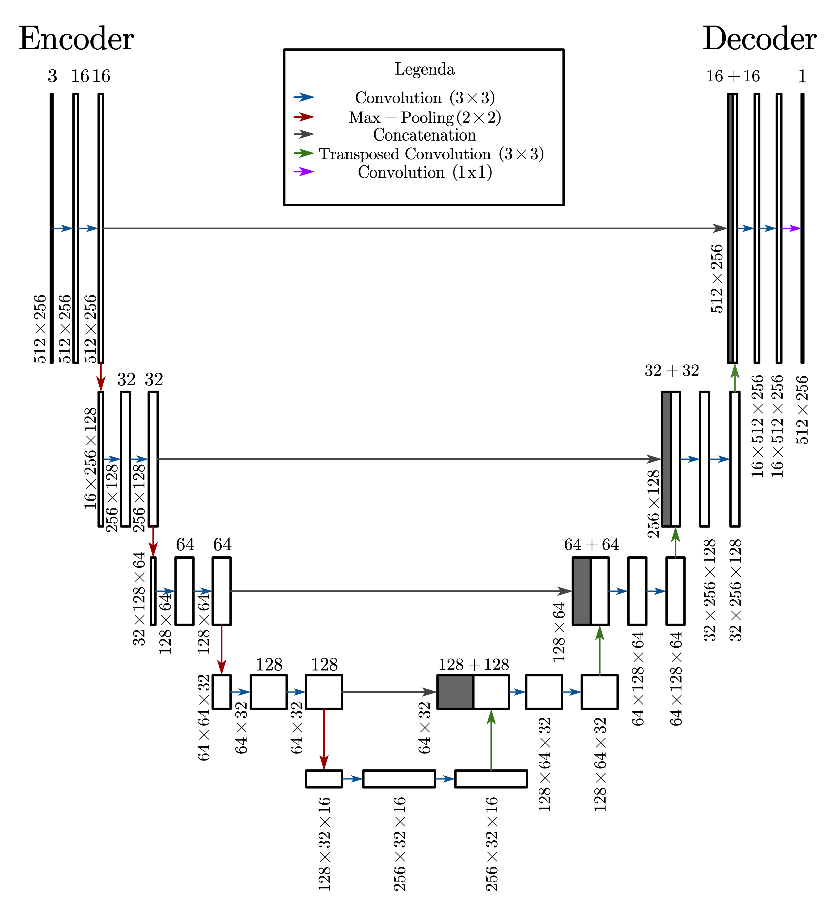

# Lane Detection with a U-Net (Keras / TensorFlow)

Binary lane-marking segmentation for ADAS-style camera images. A U-Net is trained on the [CARLANE](https://www.kaggle.com/datasets/carlanebenchmark/carlane-benchmark/data) TuLane benchmark, with a CLAHE contrast-enhancement preprocessing step implemented from scratch.

This is the practical part of my master's dissertation *Semantic Image Segmentation - Lane Detection* (Gheorghe Asachi Technical University of Iași, 2025; the dissertation itself is written in Romanian).



## Highlights

* **Model:** U-Net (about 1.9 M parameters) in Keras/TensorFlow, 512x256 input, binary focal loss (gamma = 2), Adam, IoU metric.
* **CLAHE from scratch:** `clahe.py` implements Contrast Limited Adaptive Histogram Equalization with NumPy only: per-tile histograms, clipping and redistribution of the excess, and bilinear interpolation between tiles. It is applied to the luminance channel (YCrCb).
* **Parallel preprocessing:** `parallel_preprocess_clahe.py` applies CLAHE to all training images with one worker process per CPU core.
* **Inference:** single images and video frames, with the predicted mask overlaid (section "Real Life Testing" of `LaneNet.ipynb`).

## Architecture

<p align="center">
  
</p>

Encoder-decoder U-Net with skip connections: the encoder halves the resolution four times (3x3 convolutions and 2x2 max-pooling, 16 to 256 filters), the decoder restores it with transposed convolutions and concatenates the matching encoder feature maps. The input is a 512x256 RGB image and the output is a 512x256 single-channel lane mask (1x1 convolution with a sigmoid). The network has 1,941,105 parameters.

## Results

Both runs use CLAHE-preprocessed images, Adam, binary focal loss and 200 epochs. The goal of the experiment was to show that a U-Net can be used for lane segmentation, and to measure how the training-set size (limited by the GPU memory) affects the result.

| Run | Notebook | GPU | Images used (share of TuLane) | Batch size | Train IoU | Validation IoU |
|-----|----------|-----|-------------------------------|-----------:|----------:|---------------:|
| 1 | `LaneNet.ipynb` | RTX 3050 Ti Laptop (4 GB) | 1,141 (3.5 %) | 8 | 0.454 | 0.369 |
| 2 | `linux_based/DNN_OF_RTX4090.ipynb` | RTX 4090 (24 GB) | 6,554 (20 %) | 16 | 0.525 | 0.496 |

With about 5.7 times more training images (and a batch size of 16 instead of 8, which the larger GPU memory allows), the validation IoU rises from 0.37 to 0.50. In both runs 85 % of the images are used for training and 15 % for validation, and all images are resized from 720x1280 to 256x512.

## Repository layout

| Path | Purpose |
|------|---------|
| `LaneNet.ipynb` | Main notebook: dataset split, preprocessing, U-Net, training, evaluation, inference on images/video |
| `clahe.py` | CLAHE implementation (NumPy) |
| `CLAHE.ipynb` | Step-by-step demo of CLAHE on a sample image |
| `parallel_preprocess_clahe.py` | Applies CLAHE to all training images in parallel |
| `linux_based/DNN_OF_RTX4090.ipynb` | Training notebook used on the Linux / RTX 4090 machine |
| `conda_venv_config.sh` | Creates the conda environment (`LDK`) and installs the dependencies |
| `requirements.txt` | Pinned Python dependencies (Python 3.7, TensorFlow 2.10.1) |
| `output.7z` | Trained models and training histories (optional, see below) |
| `docs/diagram/`, `docs/results/` | Figures used in this README (architecture diagram, IoU curves) |

## Setup (Windows or Linux)

The setup script is a bash script and works in **Git Bash on Windows** and in **bash on Linux**.

### 1. Install Miniconda3

Download it from the official website: [Windows](https://www.anaconda.com/docs/getting-started/miniconda/install#windows-installation) or [Linux](https://www.anaconda.com/docs/getting-started/miniconda/install#linux). Anaconda3 also works.

### 2. Make `conda` available

* **Linux:** nothing to do if `conda` works in your terminal. Otherwise the script looks for conda in `~/miniconda3`, `~/anaconda3`, `~/miniforge3`, `~/mambaforge` and `/opt/conda`.
* **Windows (Git Bash):** check with `conda --version`. If the command is not recognized, open `conda_venv_config.sh` and set `miniconda3_directory` (default `~`) or `anaconda3_directory` (default `C:\ProgramData`) to the folder where conda is installed, then run the script: it prints which paths to add to the `PATH` environment variable.

### 3. Create the environment

```bash
./conda_venv_config.sh
```

The script creates a conda environment named `LDK` (change `conda_environment_name` at the top of the script to rename it) with Python 3.7 and installs `requirements.txt`. It also offers to install **CUDA 11.2 and cuDNN 8.1**.

> [!IMPORTANT]
> `tensorflow==2.10.1` only uses the GPU if CUDA 11.2 and cuDNN 8.1 are installed. Answer `y` to the GPU question if you have an NVIDIA GPU (on Linux the script also sets `LD_LIBRARY_PATH` for the environment). Without a GPU, training 200 epochs is impractically slow. At the end the script prints the GPUs TensorFlow can see.

### 4. Download the dataset

Download the **TuLane** folder from the [CARLANE benchmark on Kaggle](https://www.kaggle.com/datasets/carlanebenchmark/carlane-benchmark/data) and place it in the repository root, so that `TuLane/splits` exists. The dataset is not part of the repository.

### 5. (Optional) Extract the trained models

Extract `output.7z` (for example with 7-Zip) into the repository root. This creates `output/final/` with the two trained models and their training histories, which the "Load Model" cells of `LaneNet.ipynb` use. Skip this step if you train from scratch.

## Running the project

Activate the environment and start JupyterLab:

```bash
conda activate LDK   # in Git Bash on Windows you can also use: source activate LDK
jupyter lab
```

Run the steps **in this order**:

1. **`LaneNet.ipynb`, up to "Split TuSimple Dataset":** creates `TuLane/training/gt_image` and `TuLane/training/gt_binary_image` from a subset of the dataset.
2. **CLAHE preprocessing** (needed because `flag_CLAHE = True` in the notebook). From the repository root, with the environment active:
   ```bash
   python parallel_preprocess_clahe.py
   ```
   CLAHE is implemented in pure Python and takes a few seconds per image, so it is applied only to the subset extracted in step 1, using one worker process per CPU core. This writes the enhanced images to `TuLane/training/clahe_gt_image`. Set `flag_CLAHE = False` in the notebook to train without CLAHE and skip this step.
3. **`LaneNet.ipynb`, from "Preprocess Data" onward:** loads the images, builds the U-Net, trains it and plots loss and IoU.
4. **Optional, "Load Model":** evaluates the pretrained models from step 5 of the setup.
5. **Optional, "Real Life Testing":** runs inference on your own image (`a7_curba.png`) and video (`a7_*.mp4`). These files are not part of the repository: put your own files in the repository root and adjust the file names in the cells, or skip this section.

## Linux / RTX 4090 notebook

`linux_based/DNN_OF_RTX4090.ipynb` was run on Linux with Python 3.10, Keras 3 and cuDNN 9.3 on an RTX 4090. That environment is **not** covered by `conda_venv_config.sh` or `requirements.txt` (which target Python 3.7 and TensorFlow 2.10.1).
